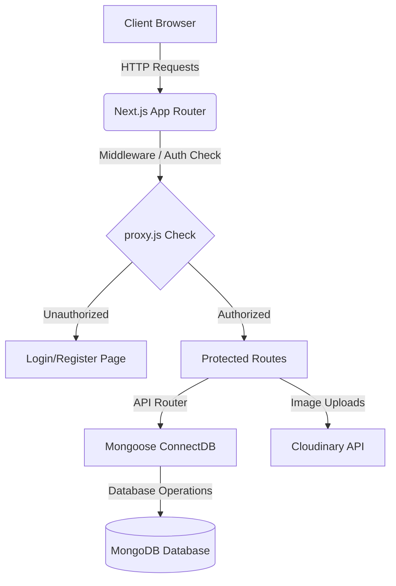
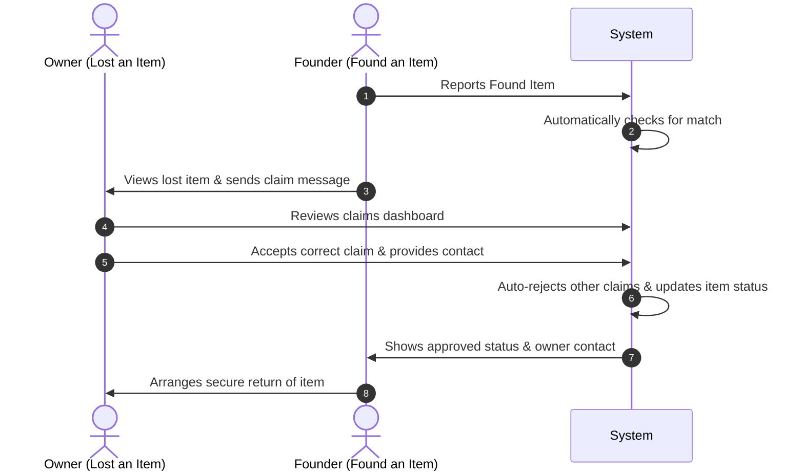

# 🔍 Lost & Found Portal

A premium, modern community platform designed to securely report, search, and match lost belongings with their finders. The platform leverages advanced matching, detailed verification workflows, and highly interactive user dashboards to make reuniting owners with their items safe and simple.

---

## 🌟 Key Features

*   **🔒 Secure Claims & Matching System**: 
    *   **Founder-to-Owner Messaging & Proof Requests**: Founders who notice a lost item can send secure messages/requests directly to the owner.
    *   **Hidden Verification Questions**: Claiming an item requires completing custom verification steps and answering questions set by the finder.
    *   **Aggregate Claim Dashboard**: Dynamic dashboard with tabs for "Submitted Claims" and "Received Claims" with live action statuses (Approve/Reject).
    *   **Automated Status Updates**: Approving a claim automatically rejects all competing claims and updates the item status in the system.
*   **👤 Advanced User Profiles & Dynamic Avatars**:
    *   **Smart Initials Generator**: Automatically generates and displays a styled single-letter avatar from the user's name upon registration.
    *   **Real-time Image Upload**: Enables seamless photo uploading to Cloudinary.
    *   **Automatic Storage Cleaning**: Automatically deletes previous profile avatar files from your Cloudinary account upon changing profile images to optimize cloud storage.
    *   **Contextual Redirection**: Automatically opens the "Edit Profile Details" form once an image is uploaded for immediate saving.
*   **🎨 Premium UI / UX**:
    *   Sleek glassmorphism details, harmonious HSL tailored color schemes, full light/dark responsiveness, and modern micro-animations powered by **Tailwind CSS**, **Lucide React**, and **Next.js**.

---

## 🛠️ Technology Stack

*   **Frontend Framework**: Next.js 16.2+ (App Router)
*   **Database**: MongoDB (Mongoose Object Modeling)
*   **Image Storage**: Cloudinary SDK Integration
*   **Authentication**: JWT (JSON Web Tokens) with Secure HttpOnly Cookies
*   **Design & Icons**: Tailwind CSS & Lucide Icons

---

## 📂 Project Architecture



---

## 🚀 Installation & Local Setup

Follow these simple steps to get the platform running locally on your machine.

### 📋 Prerequisites

Make sure you have the following installed:
*   [Node.js](https://nodejs.org/) (v18.x or newer recommended)
*   [npm](https://www.npmjs.com/) (bundled with Node)
*   A running [MongoDB](https://www.mongodb.com/) instance (local or MongoDB Atlas cluster)
*   A [Cloudinary](https://cloudinary.com/) account (free tier works perfectly)

---

### 1. Clone the Project & Install Dependencies

```bash
# Clone the repository
git clone https://github.com/your-username/lost-and-found-portal.git

# Navigate into the project folder
cd lost-and-found-portal

# Install all package dependencies
npm install
```

---

### 2. Set Up Environment Variables

Create a file named `.env` in the root of the project and populate it with your credentials:

```env
# MongoDB Connection URI
MONGODB_URI=mongodb+srv://<username>:<password>@cluster.mongodb.net/LostFoundPortal?retryWrites=true&w=majority

# JWT Token Configuration
JWT_SECRET=your_jwt_super_secret_signing_key

# Node Environment
NODE_ENV=development

# Cloudinary Integration (Copy these from your Cloudinary Console dashboard)
CLOUDINARY_CLOUD_NAME=your_cloudinary_cloud_name
CLOUDINARY_API_KEY=your_cloudinary_api_key
CLOUDINARY_API_SECRET=your_cloudinary_api_secret
```

---

### 3. Run the Development Server

Start the local development server on port `3000`:

```bash
npm run dev
```

Open [http://localhost:3000](http://localhost:3000) in your web browser to view the running app!

---

### 4. Build for Production

To compile and optimize the Next.js pages for a production deployment:

```bash
# Build the application
npm run build

# Start the compiled production bundle
npm run start
```

---

## 🔄 Core Workflows

### The Reunification Process



1.  **Item Reporting**: Users report lost items with photos, tags, dates, and locations. Other users report found items.
2.  **Claim Request & Message**: A finder/owner discovers a match and submits a Claim Request containing validation proof.
3.  **Owner Verification & Decision**: The owner reviews the validation details on their claims dashboard and clicks **Approve** or **Reject**.
4.  **Auto-Resolving Statuses**: On approval, the item state is updated, competitive claims are automatically declined, and both parties are securely put in touch.

---

## 🔒 Security Policies & Middleware

*   **HttpOnly Credentials**: Tokens are signed as JWTs and stored inside secure, HTTP-only browser cookies to block XSS and malicious token scraping.
*   **Route Guards**: Global route access control is managed via `proxy.js` middleware, securely redirecting unauthenticated traffic trying to access protected paths like `/profile`, `/dashboard`, or `/report/*` back to the login screen.